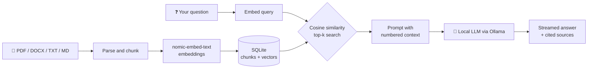

<div align="center">

# 📚 Local RAG DOC

### Chat with your documents. 100% private, 100% on your machine.

A beautiful Streamlit app that lets you ask questions about your PDFs, Word files and notes,
powered by local models through [Ollama](https://ollama.com). No API keys, no cloud, no data leaving your laptop.


</div>

---

## ✨ Features

| | |
|---|---|
| 🔀 **RAG / General switch** | One toggle flips between answering from your documents and plain chat with the model. |
| 📄 **Multi-format uploads** | PDF, DOCX, TXT and Markdown. Add new files any time, no restart needed. |
| 📎 **Cited answers** | Every RAG answer shows the exact passages, file, page number and similarity score it used. |
| ⚡ **Streaming responses** | Tokens appear as they are generated. |
| 💾 **Everything persists** | Documents, embeddings, chats and answers (with sources) are stored in SQLite and survive restarts. |
| 🗂️ **Saved chat history** | Reopen or delete any past conversation from the sidebar. Each answer is tagged with the mode it used. |
| 🎛️ **Library control** | Tick or untick a document to include it in answers, or delete it. Duplicate files are detected automatically. |
| 🧠 **Conversation memory** | Recent messages are sent along, and short follow-ups like "and the second one?" still retrieve correctly. |
| ⚙️ **Live settings** | Pick chat and embedding models, top-k, similarity threshold, temperature, context window, chunking, and show or hide model thinking. |
| 🎨 **Polished UI** | Dark violet and pink theme, gradient accents, styled chat bubbles and source cards. |

---

## 🖼️ Preview

> Add screenshots to a `docs/` folder and reference them here:
>
> ``

<p>
  
  
  
  
</p>


---

## 🧩 How it works



1. **Ingest:** files are parsed (page by page for PDFs) and split into overlapping, paragraph-aware chunks.
2. **Embed:** each chunk is embedded locally with `nomic-embed-text` and stored in SQLite as a float32 vector.
3. **Retrieve:** your question is embedded and compared against all enabled chunks by cosine similarity. The top-k passages above the threshold are kept.
4. **Generate:** the passages are sent to the chat model as numbered context, and it answers with `[1]`, `[2]` citations.
5. **Remember:** the question, answer and sources are saved, so the chat is there next time.

---

## 🚀 Quick start

### 1. Prerequisites

- **Python 3.10+**
- **[Ollama](https://ollama.com/download)** installed and running

Pull the models (any Ollama chat model works, these are just the defaults I used):

```bash
ollama pull qwen3.5-4b
ollama pull nomic-embed-text
```

### 2. Install

```bash
git clone https://github.com/<your-username>/<your-repo>.git
cd <your-repo>

python3 -m venv .venv
source .venv/bin/activate        # Windows: .venv\Scripts\activate
python3 -m pip install -r requirements.txt
```

### 3. Run

```bash
python3 -m streamlit run app.py
```

Open the URL Streamlit prints (usually <http://localhost:8501>).

> **Tip:** use `python3 -m streamlit` so the app runs with the same Python you installed the dependencies into.

---

## 🕹️ Usage

1. Open the **📄 Documents** tab in the sidebar, drop in your files and click **Index**.
2. Keep **Answer from my documents (RAG)** switched on and ask a question.
3. Expand **📎 Sources** under an answer to see exactly where it came from.
4. Switch the toggle off to chat freely with the model, with no documents involved.
5. Come back later: your chats and library are still there.

---

## ⚙️ Settings

| Setting | What it does | Default |
|---|---|---|
| Chat model | Model used to write answers | first `qwen*` model found |
| Embedding model | Model used to index and search | `nomic-embed-text` |
| Top-k | Number of passages retrieved | 4 |
| Minimum similarity | Drops weak matches | 0.35 |
| Temperature | Creativity of answers | 0.3 |
| Context window | Tokens available to the model | 4096 |
| Past messages as memory | History sent with each question | 6 |
| Show model thinking | Displays reasoning from thinking models | off |
| Chunk size / overlap | How documents are split (new files only) | 800 / 120 chars |

Set `OLLAMA_HOST` if Ollama is not on `localhost:11434`. Set `RAG_DATA_DIR` to store the database somewhere else.

---

## 📁 Project structure

```
.
├── app.py                  # Streamlit UI and chat flow
├── core.py                 # Database, parsing, chunking, Ollama client, retrieval
├── style.py                # Theme CSS and HTML components
├── requirements.txt
├── .streamlit/
│   └── config.toml         # Dark theme colours
└── data/                   # Created on first run (SQLite database)
```

---

## 🛠️ Tech stack

- **[Streamlit](https://streamlit.io)** for the interface
- **[Ollama](https://ollama.com)** for local LLM and embedding inference
- **SQLite** for documents, vectors, chats and messages
- **NumPy** for similarity search
- **pypdf** and **python-docx** for document parsing

---

## 🩺 Troubleshooting

| Problem | Fix |
|---|---|
| `No module named 'pypdf'` | Dependencies are in a different Python. Run `python3 -m pip install -r requirements.txt`, then `python3 -m streamlit run app.py`. |
| "Can't reach Ollama" | Start it with `ollama serve` or open the Ollama app. |
| Answers say "couldn't find it" | Lower **Minimum similarity**, raise **Top-k**, or try a larger chunk size and re-upload. |
| A PDF indexes zero chunks | It is probably a scanned image with no text layer. OCR is not supported yet. |
| Documents not searchable after changing the embedding model | Each document only works with the model it was indexed with. Delete and re-upload. |
| Slow responses | Keep the context window at 4096 and top-k at 3 or 4, or use a smaller model. |

---

## 🔒 Privacy

Everything runs locally. Your documents, embeddings and conversations are stored in `data/rag.db` on your own disk, and model inference happens through your local Ollama server. Delete the `data/` folder to wipe it all.

---

## 🗺️ Roadmap

- [ ] OCR for scanned PDFs
- [ ] Re-index button when switching embedding models
- [ ] Hybrid search (keyword + vector)
- [ ] Export chats to Markdown
- [ ] Docker setup

---

## 🤝 Contributing

Issues and pull requests are welcome. Fork the repo, create a branch, and open a PR.

## 📄 License

Released under the [MIT License](LICENSE).

<div align="center">

Built with Python, Streamlit and Ollama.

</div>
# ragDoc
