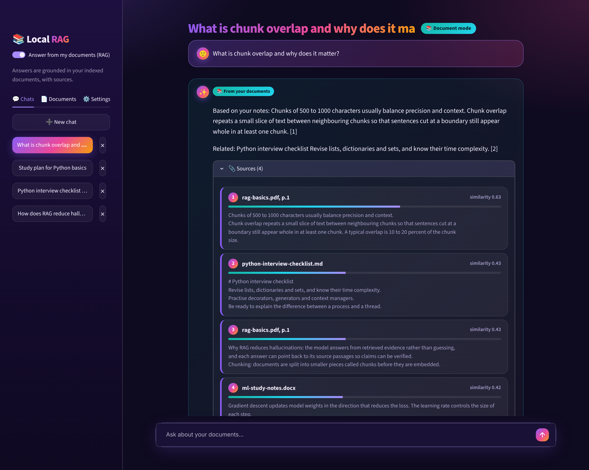
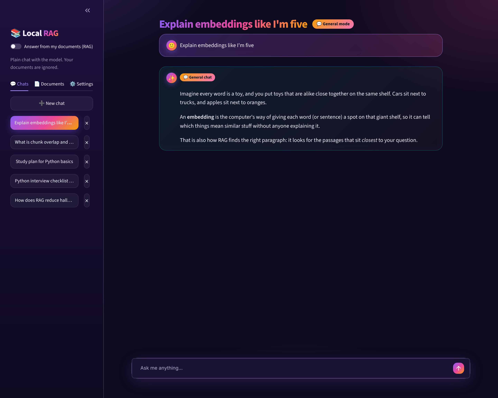
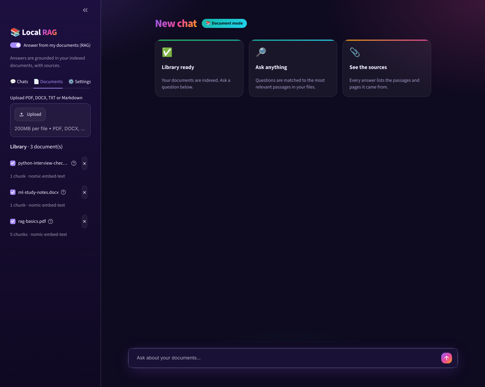
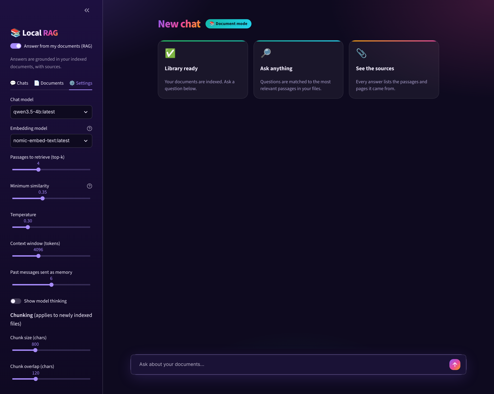
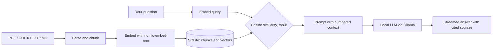

<div align="center">
# Local RAG DOC
 
### Chat with your documents. Private, local, and fully cited.
 
A Streamlit application for question answering over your own PDFs, Word files and notes.
Retrieval-Augmented Generation (RAG) runs entirely on your machine through [Ollama](https://ollama.com):
no API keys, no cloud services, and no data leaving your computer.
 


 
</div>
---
 
## Table of contents
 
- [Overview](#overview)
- [Screenshots](#screenshots)
- [Features](#features)
- [How it works](#how-it-works)
- [Getting started](#getting-started)
- [Usage guide](#usage-guide)
- [Configuration](#configuration)
- [Architecture and data model](#architecture-and-data-model)
- [Design decisions](#design-decisions)
- [Limitations](#limitations)
- [Troubleshooting](#troubleshooting)
- [Privacy](#privacy)
- [Roadmap](#roadmap)
- [Contributing](#contributing)
- [License](#license)
---
 
## Overview
 
Large language models are good at writing but cannot know what is inside your private files, and they may confidently invent answers when asked about them. **Local RAG DOC** solves this by retrieving the most relevant passages from your own documents and handing them to a local model as context. Every answer comes with the exact passages it was built from, so you can verify it instead of trusting it.
 
The application is designed for individual use on a laptop. It pairs a polished chat interface with a small, readable codebase (three Python files) and stores everything in a single SQLite database, so there is nothing to host and nothing to configure beyond Ollama.
 
**Typical uses:** studying from lecture notes and textbooks, searching long reports or manuals, preparing for interviews from your own notes, and querying research papers.
 
---
 
## Screenshots
 
<table>
  <tr>
    <td></td>
    <td></td>
  </tr>
  <tr>
    <td align="center"><sub><b>Document Q&A</b> with numbered citations, page numbers and similarity scores</sub></td>
    <td align="center"><sub><b>General chat</b> mode for questions that do not need your documents</sub></td>
  </tr>
  <tr>
    <td></td>
    <td></td>
  </tr>
  <tr>
    <td align="center"><sub><b>Document library</b> with upload, include/exclude and delete controls</sub></td>
    <td align="center"><sub><b>Settings</b> for models, retrieval and chunking</sub></td>
  </tr>
</table>
---
 
## Features
 
### Question answering
 
- **Grounded answers with citations.** In document mode, the model is instructed to answer only from the retrieved excerpts and to cite them as `[1]`, `[2]`. If the documents do not contain the answer, it says so rather than guessing.
- **Transparent sources.** Each answer has an expandable *Sources* panel listing every passage that was sent to the model, with the file name, PDF page number and a cosine similarity score shown as a bar. You can see at a glance how strong each match was.
- **Streaming responses.** Text appears token by token as the model generates it, so long answers feel responsive.
- **Conversation memory.** The most recent messages (6 by default) are sent with each question, so follow-ups such as "and what about the second one?" work naturally. For short follow-ups, the previous question is combined with the new one when searching, so retrieval still finds the right passages.
- **Thinking-model support.** Models that emit reasoning (such as Qwen3-family models) are supported. Reasoning can be shown in a collapsible panel or hidden. Inline `<think>` blocks are filtered out of the final answer either way.
### Two modes in one app
 
- **RAG / General switch.** A single toggle in the sidebar switches between answering from your documents and chatting with the model directly. The two can be mixed freely within a conversation.
- **Mode tags on every answer.** Each reply is labelled with the mode that produced it, so a saved chat always shows whether an answer was grounded in documents or came from the model alone.
### Document management
 
- **Multiple formats.** PDF (with page numbers preserved), DOCX (paragraphs and tables), plain text and Markdown.
- **Upload at any time.** Add files from the sidebar whenever you like. No restart and no re-indexing of existing files is needed.
- **Duplicate detection.** Files are identified by a SHA-256 hash of their content, so uploading the same file twice does nothing.
- **Library controls.** Each document can be switched off to exclude it from answers without deleting it, or deleted permanently along with its embeddings.
- **Clear indexing feedback.** A progress bar shows chunk-by-chunk progress, and each file reports whether it was indexed, skipped as a duplicate, or contained no extractable text.
### Persistence
 
- **Everything is saved.** Documents, embeddings, chats, answers and their sources live in a local SQLite database and survive restarts.
- **Saved chat history.** Past conversations appear in the sidebar. Reopen any of them to continue, or delete the ones you no longer need.
- **Answers keep their evidence.** The retrieved passages are stored alongside each answer, so old chats still show exactly what the answer was based on, even if you later delete the source document.
### Control and customisation
 
- **Model selection.** Chat and embedding models are discovered automatically from your running Ollama server. Any installed chat model can be used.
- **Retrieval tuning.** Adjust how many passages are retrieved (top-k) and the minimum similarity a passage needs to be included.
- **Generation tuning.** Adjust temperature, context window size, and how much chat history is sent.
- **Chunking tuning.** Adjust chunk size and overlap to suit your documents. These apply to newly indexed files.
### Interface
 
- A dark violet and pink theme with gradient accents, styled chat bubbles with avatars, a mode badge in the header, welcome cards that adapt to the current mode, and card-style source citations.
- Clear error states when Ollama is unreachable, when no documents are available for the selected embedding model, or when a generation fails.
---
 
## How it works
 

 
### Indexing a document
 
1. **Parse.** Text is extracted page by page for PDFs, from paragraphs and tables for DOCX, and directly for TXT and Markdown.
2. **Chunk.** Text is split into passages of about 800 characters (configurable). The splitter keeps paragraphs together where possible, splits overly long paragraphs at sentence boundaries, and repeats a small overlap (120 characters by default, trimmed to a word boundary) between neighbouring chunks so that sentences cut at a boundary still appear whole in at least one chunk.
3. **Embed.** Chunks are sent to the embedding model in batches of 16. Vectors are L2-normalised, so cosine similarity reduces to a dot product.
4. **Store.** Chunks, page numbers and float32 vectors are written to SQLite in a single transaction, so a failed indexing run never leaves a half-indexed document behind.
### Answering a question
 
1. **Embed the query** with the same embedding model used for the documents. For `nomic-embed-text`, the recommended `search_query:` and `search_document:` task prefixes are applied automatically, which noticeably improves retrieval quality.
2. **Search.** The query vector is compared against every chunk from enabled documents that were indexed with the selected embedding model. The top-k results at or above the minimum similarity are kept.
3. **Build the prompt.** A system prompt tells the model to rely only on the numbered excerpts, to admit when the answer is missing, and to cite sources. Recent chat history is added as normal turns, and the excerpts plus the question form the final message.
4. **Generate and stream.** The prompt is sent to the chat model through Ollama's streaming API and rendered as it arrives.
5. **Save.** The question, the answer, the mode and the retrieved sources are stored together in the chat history.
---
 
## Getting started
 
### Prerequisites
 
- **Python 3.10 or newer**
- **[Ollama](https://ollama.com/download)** installed and running
Pull a chat model and an embedding model. These are the defaults the app was built and tested with, but any Ollama chat model will work:
 
```bash
ollama pull qwen3.5-4b
ollama pull nomic-embed-text
```
 
### Installation
 
```bash
git clone https://github.com/chiruu-git/ragDoc
cd ragDoc
 
python3 -m venv .venv
source .venv/bin/activate          # Windows: .venv\Scripts\activate
python3 -m pip install -r requirements.txt
```
 
### Run
 
```bash
python3 -m streamlit run app.py
```
 
Open the URL that Streamlit prints, usually <http://localhost:8501>.
 
> **Tip:** run Streamlit as `python3 -m streamlit` so it uses the same Python environment you installed the dependencies into.
 
---
 
## Usage guide
 
1. **Add documents.** Open the **Documents** tab in the sidebar, drop in one or more files and click **Index**. Wait for the confirmation message.
2. **Ask a question.** With **Answer from my documents (RAG)** switched on, type a question in the chat box.
3. **Check the evidence.** Expand **Sources** under the answer to see the passages, pages and similarity scores behind it.
4. **Tune if needed.** If answers miss information, open **Settings** and lower the minimum similarity or raise top-k.
5. **Chat freely.** Switch the toggle off to talk to the model without involving your documents.
6. **Come back later.** Chats and the document library are saved. Reopen any chat from the **Chats** tab.
7. **Manage the library.** Untick a document to exclude it from answers, or delete it with the × button.
---
 
## Configuration
 
### Settings panel
 
| Setting | Purpose | Default |
|---|---|---|
| Chat model | Model that writes the answers | First `qwen*` model found, otherwise the first chat model |
| Embedding model | Model used to index and search | `nomic-embed-text` |
| Passages to retrieve (top-k) | Number of passages sent to the model | 4 |
| Minimum similarity | Passages scoring below this are dropped | 0.35 |
| Temperature | Randomness of the answer | 0.3 |
| Context window | Tokens available to the model | 4096 |
| Past messages as memory | Chat history sent with each question | 6 |
| Show model thinking | Display reasoning from thinking models | Off |
| Chunk size | Target characters per chunk (new files only) | 800 |
| Chunk overlap | Characters repeated between chunks (new files only) | 120 |
 
### Environment variables
 
| Variable | Purpose | Default |
|---|---|---|
| `OLLAMA_HOST` | Address of the Ollama server | `http://localhost:11434` |
| `RAG_DATA_DIR` | Folder for the SQLite database | `./data` |
 
### Tuning tips
 
- **"Couldn't find it" too often:** lower *Minimum similarity* to around 0.25, or raise *top-k*.
- **Answers lack surrounding context:** increase chunk size to 1000 to 1200 and re-upload the file.
- **Slow responses on a laptop:** keep the context window at 4096, use top-k of 3 or 4, or choose a smaller model.
---
 
## Architecture and data model
 
### Project structure
 
```
.
├── app.py                  # Streamlit interface and chat flow
├── core.py                 # Database, parsing, chunking, Ollama client, retrieval
├── style.py                # Theme CSS and HTML components
├── requirements.txt        # Python dependencies
├── .streamlit/
│   └── config.toml         # Theme colours
├── docs/                   # README screenshots
└── data/                   # Created on first run (SQLite database, git-ignored)
```
 
`core.py` has no dependency on Streamlit, so the retrieval and storage logic can be reused or tested on its own.
 
### Database schema
 
| Table | Contents |
|---|---|
| `documents` | One row per uploaded file: name, content hash, type, chunk count, embedding model, enabled flag |
| `chunks` | Passage text, page number and the float32 embedding vector, linked to a document |
| `chats` | One row per conversation: title and timestamps |
| `messages` | Each question and answer, with its mode and the retrieved sources stored as JSON |
 
Foreign keys cascade, so deleting a document removes its chunks and deleting a chat removes its messages.
 
### Tech stack
 
| Component | Technology |
|---|---|
| Interface | [Streamlit](https://streamlit.io) with custom CSS |
| LLM and embeddings | [Ollama](https://ollama.com) |
| Storage | SQLite |
| Similarity search | NumPy |
| Document parsing | `pypdf`, `python-docx` |
| HTTP client | `requests` |
 
---
 
## Design decisions
 
- **SQLite and NumPy instead of a vector database.** For the personal-scale collections this app targets, a brute-force dot product over a few thousand vectors takes milliseconds. This keeps installation to a single `pip install`, makes the data easy to inspect, and avoids running a separate service.
- **Task prefixes for `nomic-embed-text`.** The model was trained with distinct prefixes for queries and documents, and retrieval quality drops without them, so the app adds them automatically.
- **Paragraph-aware chunking with overlap.** Splitting on paragraph and sentence boundaries keeps ideas intact, and the overlap protects sentences that fall on a boundary.
- **Evidence stored with each answer.** Saving the retrieved passages makes saved chats self-contained and auditable.
- **Embedding model recorded per document.** Vectors from different models are not comparable, so each document remembers which model indexed it and is only searched with that model.
---
 
## Limitations
 
- **No OCR.** Scanned PDFs without a text layer cannot be indexed.
- **Changing the embedding model requires re-uploading documents**, because each document is only searchable with the model that indexed it.
- **Brute-force search.** Designed for personal collections (up to tens of thousands of chunks), not for very large corpora.
- **Single-user, local app.** There is no authentication or multi-user support.
- **Answer quality depends on the local model.** Small models can misread context. Use the Sources panel to verify important answers.
---
 
## Troubleshooting
 
| Problem | Fix |
|---|---|
| `No module named 'pypdf'` | Dependencies are installed in a different Python. Run `python3 -m pip install -r requirements.txt`, then `python3 -m streamlit run app.py`. |
| "Can't reach Ollama" | Start it with `ollama serve` or open the Ollama app. If it runs elsewhere, set `OLLAMA_HOST`. |
| Answers often say the information was not found | Lower **Minimum similarity**, raise **top-k**, or re-upload with a larger chunk size. |
| A PDF indexes zero chunks | It is probably a scanned image with no text layer. OCR is not supported yet. |
| Documents are not searchable after changing the embedding model | Each document only works with the model it was indexed with. Delete and re-upload it. |
| Responses are slow | Keep the context window at 4096, use top-k of 3 or 4, or switch to a smaller model. |
 
---
 
## Privacy
 
Everything runs locally. Documents, embeddings and conversations are stored in `data/rag.db` on your own disk, and all model inference goes through your local Ollama server. No telemetry or external API calls are made by the application. To remove all stored data, delete the `data/` folder.
 
---
 
## Roadmap
 
- [ ] OCR support for scanned PDFs
- [ ] One-click re-indexing when switching embedding models
- [ ] Hybrid search (keyword and vector)
- [ ] Export chats to Markdown
- [ ] Docker setup
---
 
## Contributing
 
Issues and pull requests are welcome. To contribute, fork the repository, create a feature branch, make your changes and open a pull request describing what you changed and why.
 
---
 
## License
 
Released under the [MIT License](LICENSE).
 
<div align="center">
Built with Python, Streamlit and Ollama.
 
</div>
 